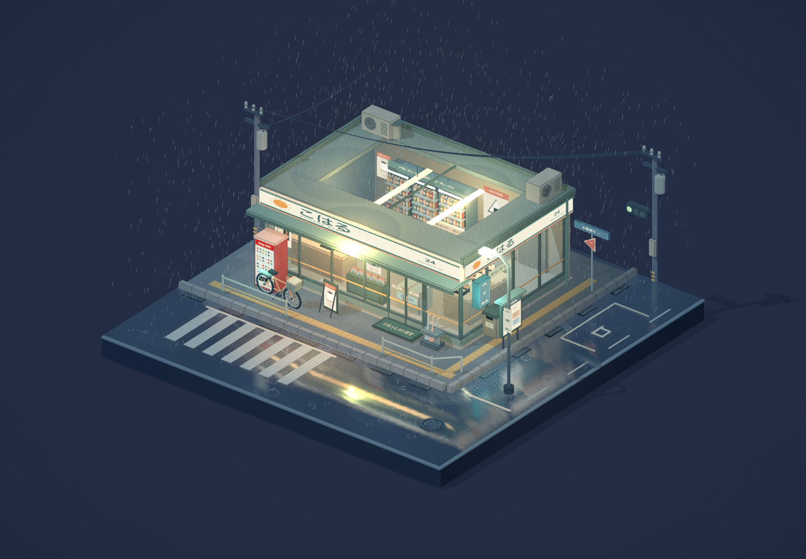
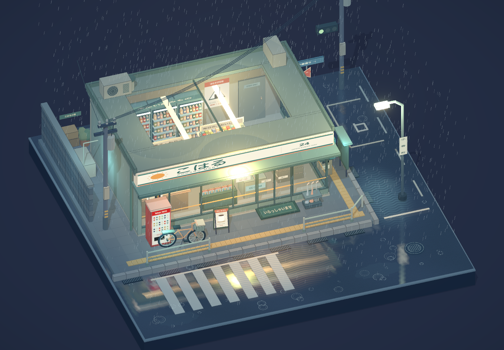
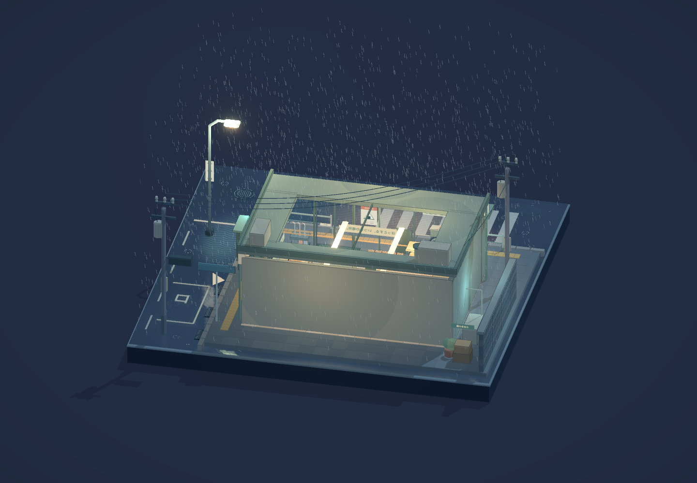

# 雨宿り · Koharu After Rain

一个可自由旋转、缩放、平移观看的日式雨夜便利店微缩景观。所有建筑与街景收在完整的 16 × 16 正方形底座内；页面只有实时三维画面，没有标题、按钮、菜单或操作提示。

## 在线体验

[打开雨宿り · Koharu After Rain](https://gn3m1x.github.io/koharu-after-rain/)，可直接在浏览器中拖拽旋转、缩放和查看整个微缩场景。

## 实际运行截图

以下截图来自生产构建的真实浏览器验收，展示完整微缩场景、可见的便利店室内和模型背面。



| 店内细节 | 模型背面 |
| --- | --- |
|  |  |

生产版浏览器验收结果为 **18 / 18 通过**，无运行或 Shader 错误、无外部素材请求。更多截图、测试项目和验证范围见 [TESTING.md](TESTING.md)。

直接用 React、TypeScript、Three.js / React Three Fiber 编写程序化模型。未使用 Blender、外部模型、照片、视频或生成图片。招牌、包装和海报由 Canvas 绘制，天气由 GLSL 着色器驱动。

## 运行

需要 Node.js 22.12+、npm 和支持 WebGL 2 的浏览器。

```bash
npm ci
npm run dev
```

打开终端中的地址（默认 http://127.0.0.1:5173/）。

```bash
npm run build
npm run preview
```

生产文件输出在 `dist/`，可通过静态 HTTP 服务器运行。运行时不请求外部素材。

## 操作

| 输入 | 动作 |
| --- | --- |
| 左键拖动 / 单指拖动 | 自由环绕旋转，可查看背面 |
| 滚轮 / 双指缩放 | 推近或拉远 |
| 右键拖动 / 双指拖动 | 平移观察目标 |
| 双击 | 恢复初始构图与缩放 |

相机采用正交投影，默认以完整的第三视角观看模型。旋转没有方位角限制，俯仰范围限制在底座上方；缩放和平移有合理边界。视口变化会自动重新适配初始缩放。

## 场景内容

- **便利店**：原创「こはる / KOHARU MART」招牌、转角玻璃、滑动自动门、雨棚、迎宾地垫、海报、ATM 灯箱。屋顶有玻璃天窗、空调外机、通风帽、屋边及落水管，便于从上方观看店内。
- **室内**：带包装标签的多层货架、逐瓶陈列的饮料冷柜、冷藏便当与三角饭团、收银台和终端、咖啡机与咖啡杯、关东煮玻璃柜、杂志架、冰柜、吊挂灯箱、地砖、地面导视和后场门。
- **街角**：L 形道路、斑马线、侧街停车位、盲道、砖铺人行道、排水沟与雨篦、井盖、护栏、贩卖机、带车筐自行车、伞架、分类垃圾桶、路灯、街道路牌、交通灯、电线杆和垂落电线。
- **小巷**：砖墙、空调外机、管道、堆放纸箱、小植物、巷名牌与公告栏。
- **细微动态**：持续降雨、雨棚滴水、积水涟漪、玻璃滑落水痕、招牌微闪、约 19 秒一轮的自动门、约 12 秒切换的交通灯。

## 渲染

主体使用四阶明暗的 Toon 材质与几何轮廓线，重复商品和铺装使用实例化批次。冷蓝色外部照明与暖色店内灯光形成层次，湿路使用真实平面捕获、模糊、水膜混合及柔和灯光斑。阴影、ACES 色调映射和少量 Bloom 保留模型感。

雨水、水痕和波纹采用视觉模拟，不进行流体计算。雨丝在便利店区域避开屋顶下方；天窗和橱窗采用透明材质。无人物和车辆。本次不包含第一人称漫游、界面设置或音频自动播放。

## 文件

| 文件 | 内容 |
| --- | --- |
| `src/App.tsx`、`src/styles.css` | 无 UI 的全屏画布 |
| `src/config.ts`、`src/scene/CameraRig.tsx` | 初始构图、轨道控制、响应式适配与复位 |
| `src/scene/ConvenienceStore.tsx` | 建筑、完整室内、招牌、自动门和门口设施 |
| `src/scene/Neighborhood.tsx` | 自行车、电线、路灯、设备、公告栏和小巷 |
| `src/scene/Street.tsx`、`WetRoad.tsx` | 正方形底座、街道、铺装、排水和正交相机平面反射 |
| `src/scene/Weather.tsx` | GPU 雨、滴水、波纹、水痕和灯光斑 |
| `src/scene/Primitives.tsx`、`materials.ts` | 卡通材质、轮廓批次、建模组件和程序化贴图 |
| `scripts/browser-smoke.mjs` | Chrome 浏览器验收检查 |

## 浏览器验收

安装独立的浏览器验收依赖，并启动本地服务器后执行（不会修改依赖锁文件）：

```bash
npm install --no-save --package-lock=false playwright
node scripts/browser-smoke.mjs http://127.0.0.1:5173/
```

脚本使用已安装的 Google Chrome，以 1440 × 1000 和 390 × 844 视口检查实际渲染、无 UI、旋转、背面观察、缩放、平移、复位、自动门、交通灯、动画推进和外部资源请求。截图与结果保存到 `output/playwright/koharu/`，该目录默认不加入 Git。实际执行结果见 `TESTING.md`。

验收脚本也支持 `PLAYWRIGHT_MODULE_PATH` 指向现有 Playwright 的 `index.mjs`，无需在应用项目安装测试依赖。本次使用 Codex 捆绑的 Playwright 运行。
